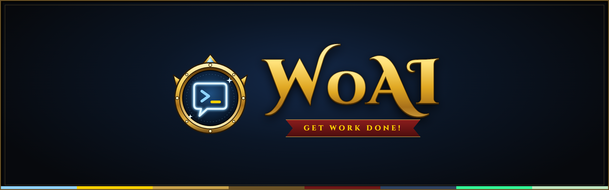

<p align="center"></p>

# WoAI

<p align="center"><a href="README.md">English</a> · <b>Español</b></p>

Addon para **WoW Forever** (interfaz `16001`) para leer y continuar tus conversaciones con **Claude Code** y **Codex** sin salir del juego.

## Instalar la app (recomendado)

La app de escritorio **WoAI** instala el addon, deja el companion funcionando en segundo plano y te deja configurarlo todo sin terminal. No hace falta Node.

1. Descarga el instalador desde [Releases](https://github.com/alcheco/world-of-ai/releases/latest):
   - **macOS:** `WoAI_…_AppleSilicon.dmg` (chip M1 o posterior) o `WoAI_…_Intel.dmg`. Ábrelo y arrastra **WoAI** a **Aplicaciones**.
   - **Windows:** `WoAI_…_x64-setup.exe`.
2. Abre WoAI. Un asistente corto te pide el idioma, encuentra WoW Forever, detecta `claude` y `codex`, te deja elegir qué pueden hacer los agentes e instala el addon.
3. **Cierra WoW del todo y vuelve a abrirlo**, y activa **WoAI** y todos los **WoAI slot** en AddOns (pasos 4 y 5 de abajo).

En **General** eliges si WoAI se ve como ventana normal o solo en la barra de menús / bandeja, y si se abre al iniciar sesión. Cerrar la ventana no detiene el companion; para salir, usa **Salir de WoAI**. Si está solo en la barra de menús y no encuentras el icono, abre WoAI otra vez desde Aplicaciones y se muestra la ventana. Las actualizaciones se instalan desde la propia app.

> La versión de macOS aún no está notarizada. Si macOS dice que la app «está dañada» o «no se puede abrir», ejecuta una vez `xattr -dr com.apple.quarantine /Applications/WoAI.app`.

El resto de esta página explica cómo usarlo desde el repo (para desarrollo).

## Cómo funciona

Los addons de WoW no pueden usar la red ni ejecutar programas. Por eso WoAI tiene dos partes:

| Parte | Dónde corre | Qué hace |
|---|---|---|
| `addon/WoAI` | Dentro del juego | Muestra la UI, lee `Data.lua` y envía cada prompt como una captura de pantalla (y, de respaldo, en `WoAI_DB.outbox`, SavedVariables). |
| `addon` `WoAI_S001…S100` | Dentro del juego | Buzones *LoadOnDemand* por los que llegan las respuestas sin `/reload`. |
| `companion/` | En tu Mac (Node ≥ 22) | Vigila `Screenshots/` y las SavedVariables, ejecuta cada prompt con `claude -p --resume` o `codex exec resume`, reescribe `Data.lua` con las sesiones de `~/.claude/projects` y `~/.codex/sessions` y publica cada respuesta en los buzones. |

```
escribes el prompt ─► captura ─► el companion lo ejecuta ─► la respuesta aparece sola
```

**Ida (sin `/reload`):** el juego solo escribe las SavedVariables al hacer `/reload` o al cerrar sesión, pero `Screenshot()` escribe un archivo al momento. Al pulsar **Enviar**, el addon dibuja el prompt durante un instante como una cuadrícula de celdas de color en la esquina superior izquierda (verás un parpadeo) y hace una captura en PNG. El companion la decodifica (mide las celdas, calibra los colores y comprueba un checksum), encola el prompt y borra la captura; tus capturas normales no se tocan. Si la captura falla, el prompt sigue en la outbox y sale con el próximo `/reload`. `/woai enviar` reintenta los que no salieron.

**Vuelta (sin `/reload`):** un addon *LoadOnDemand* lee su Lua del disco en el momento en que se carga. El companion escribe cada actualización en los 100 buzones `WoAI_S001…` y el addon carga el siguiente libre. Para saber cuándo, el addon prueba cada 2 s si `sig/NNN.wav` se puede reproducir: el companion convierte ese `.wav` vacío en uno válido (silencioso) cuando termina un prompt. Si las señales no funcionan (por ejemplo, con el sonido apagado), el addon carga buzones con un calendario (10 s, 25 s, 45 s, 75 s, 2 min y luego cada 2 min) mientras haya prompts esperando. Cada buzón se puede usar una vez por sesión de UI; `/reload` los libera todos.

El juego solo descubre archivos que existían al arrancar, así que `npm run install-addon` los crea de antemano y luego hay que **cerrar WoW del todo y volver a abrirlo** una vez.

## Tutorial: cargarlo por primera vez

### 0. Requisitos

- macOS con **WoW Forever** instalado (por defecto en `/Applications/World of Warcraft/_forever_`).
- **Node.js 22 o superior** (`node -v`).
- Al menos uno de los CLIs, ya con sesión iniciada:
  - **Claude Code:** `claude` (pruébalo con `claude -p "hola"`).
  - **Codex:** `codex` (pruébalo con `codex exec "hola"`).

### 1. Clonar el repo

```bash
git clone https://github.com/alcheco/world-of-ai.git
```

```bash
cd world-of-ai/companion
```

### 2. Configurar (opcional, pero recomendado)

Crea `companion/config.json`. Con este contenido Claude puede editar archivos cuando le escribes desde el juego:

```json
{
  "claude": { "permissionMode": "acceptEdits" },
  "codex": { "sandbox": "workspace-write" }
}
```

Si tu WoW Forever está en otra carpeta, agrega `"wowDir": "/ruta/a/_forever_"`. Las demás opciones están en [Configuración](#configuración).

### 3. Instalar el addon en el juego

```bash
npm run install-addon
```

Este comando:
- Enlaza `addon/WoAI` en `_forever_/Interface/AddOns/WoAI`. Es un enlace simbólico, así que lo que cambies en el repo se ve en el juego.
- Crea los 100 buzones `WoAI_S001…WoAI_S100` y los archivos de señales del canal en vivo.

### 4. Reiniciar WoW por completo

**Cierra el juego del todo y vuelve a abrirlo.** Un `/reload` no alcanza: WoW solo descubre archivos nuevos al arrancar. Haz esto también cada vez que el addon tenga un archivo `.lua` nuevo.

### 5. Activar los addons

En la pantalla de selección de personaje, abre **AddOns** (abajo a la izquierda):
- Marca **WoAI** y todos los **WoAI slot …**. Aparecen agrupados bajo *WoAI*.
- Si aparecen como "desactualizados", marca **Cargar addons desactualizados**.

### 6. Arrancar el companion

En una terminal, y déjala abierta mientras juegas:

```bash
npm start
```

Deberías ver `[woai] SavedVariables vigiladas: …` y `[data] Data.lua actualizado: N sesiones`.

### 7. Entrar al juego y probar

1. Entra con tu personaje. En el chat aparece `WoAI: N sesiones…`.
2. Abre la ventana con el **botón del libro en el minimapa**, con `/woai` o desde el compartimento de addons.
3. Pulsa **+ Nueva**, elige el agente (Claude o Codex) y una carpeta, escribe `hola` y pulsa **Enviar**.
4. Verás un parpadeo en la esquina superior izquierda (es el prompt saliendo como captura) y una misión *Esperando respuesta* bajo el rastreador de misiones.
5. Cuando el agente termina, aparece el banner **"¡Misión completada!"**. Haz clic en la misión para abrir la conversación.

### Si algo no funciona

| Síntoma | Qué hacer |
|---|---|
| No aparece el botón del minimapa ni `/woai` | Comprueba que WoAI esté activo y reinicia WoW por completo (paso 4). |
| La ventana dice "Sin datos" | El companion no está corriendo o no encuentra la carpeta del juego. Revisa la terminal y `wowDir`. |
| El prompt no sale | `/woai enviar` lo reintenta. Si no, sale con el próximo `/reload`. |
| La respuesta no llega sola | `/woai estado` muestra el canal en vivo y los buzones libres. `/woai poll` fuerza la lectura, y `/reload` siempre funciona. |
| Claude responde que no puede editar | Pon `"permissionMode": "acceptEdits"` en `config.json` y reinicia el companion. |
| Salen errores de Lua | Copia el error completo y repórtalo. |

Para desinstalarlo: `npm run uninstall-addon` (borra `_forever_/Interface/AddOns/WoAI` y las carpetas `WoAI_S*`; si era un enlace, el repo no se toca).

## Uso

- **Botón del minimapa:** clic abre la ventana, clic derecho pliega las misiones y arrastrar lo mueve por el borde. Muestra un punto verde si hay respuestas nuevas.
- **Ventana:** se mueve arrastrando y cambia de tamaño desde la esquina inferior derecha. Recuerda posición y tamaño.
- **Markdown en las respuestas:** títulos más grandes en dorado, bloques de código en un recuadro oscuro con su lenguaje, tablas como una cuadrícula con cabecera, listas con viñetas o números (también anidadas y con casillas), citas, y colores para **negrita**, *cursiva*, `código` y enlaces.
- **Lista de la izquierda:** las sesiones recientes **agrupadas por proyecto** (repo). Los worktrees de Claude (`.claude/worktrees/…`) y de Codex (`~/.codex/worktrees/…`) van en el grupo de su repo. Una franja de color indica el agente: naranja para Claude, verde para Codex. Clic en un proyecto lo pliega. Hay filtros *Todos / Claude / Codex* y una búsqueda.
- **Misiones WoAI:** un bloque bajo el rastreador de misiones con cada prompt como si fuera una misión: *Enviando…*, *Esperando respuesta* o *Respuesta lista*. Al entrar con respuestas nuevas aparece el banner "¡Misión completada!" con su sonido.
  - Clic en una misión: abre la conversación.
  - Clic derecho en una misión: la descarta.
  - Mayús + arrastrar: mueve el bloque.
  - Clic derecho en la cabecera: lo devuelve bajo las misiones.
- **Cuidado al continuar una sesión que tienes abierta** en Claude Code o Codex: el companion la retoma en paralelo, así que esa respuesta no aparecerá en la app que tienes abierta.
- **Continuar una sesión:** elígela, escribe el prompt y pulsa **Enviar**. No hace falta `/reload`: la respuesta aparece sola cuando el companion termina, con el banner de misión completada.
- **`/woai estado`:** muestra si el canal en vivo funciona, cuántos buzones quedan y cuántos prompts esperan. **`/woai poll`** carga un buzón ya.
- **+ Nueva:** el botón de agente cambia entre Claude y Codex. El de carpeta recorre los proyectos que conoce el companion y, al final, **Solo chat**: una conversación sin carpeta de trabajo ni herramientas, que no crea nada en el disco. Claude corre sin herramientas; Codex no permite quitarlas todas, así que corre en solo lectura. Estas conversaciones se agrupan en "Solo chat" y siguen así al continuarlas.
- **Estados de un prompt:** *enviando…*, *en cola*, *ejecutando…*, *listo* o *error* (el error trae el mensaje del CLI). Las respuestas llegan sin `/reload` mientras queden buzones; si se acaban, haz `/reload`.

## Configuración

Crea `companion/config.json` (opcional) para cambiar los valores por defecto:

```json
{
  "wowDir": "/Applications/World of Warcraft/_forever_",
  "maxSessions": 40,
  "maxMessages": 60,
  "claude": { "permissionMode": "acceptEdits" },
  "codex": { "sandbox": "workspace-write" }
}
```

- `claude.permissionMode`: con `default`, Claude **no** puede usar herramientas que pidan permiso, porque desde el juego no hay forma de aprobarlas. Usa `acceptEdits` si quieres que edite archivos.
- `codex.sandbox`: `read-only`, `workspace-write` o `danger-full-access`.
- `wowDir`: si no lo pones, el companion busca WoW Forever en las rutas habituales de macOS y Windows (y, en Windows, en la instalación registrada por Battle.net).
- `claude.bin` / `codex.bin`: nombre o ruta del CLI. El companion completa el PATH con el de tu shell de login y carpetas habituales (`~/.local/bin`, Homebrew, npm global), así que normalmente no hace falta.
- `lang`: idioma de los mensajes del companion, `es` o `en`.
- Variables de entorno: `WOAI_WOW_DIR` (carpeta del juego), `WOAI_LANG`, `WOAI_DATA_DIR` (dónde están `config.json` y `.state.json`; por defecto `companion/`) y `WOAI_ADDON_SRC` (copiar el addon desde otra carpeta en vez de enlazar el del repo).

## Desarrollo

```bash
cd companion && npm test      # tests
npm run once                  # procesa la outbox una vez y regenera Data.lua
npm run install-addon -- --copy   # instala el addon copiándolo, como la app
npm run build:bin             # binario único (Node SEA) en dist/woai-companion-<target>
```

El binario es lo que empaqueta la app de escritorio (ver [docs/plan-instalador.md](docs/plan-instalador.md)). Se compila en cada plataforma con su propio Node. Con `--ipc` habla con la app por JSON; el protocolo está en [docs/companion-ipc.md](docs/companion-ipc.md).

### App de escritorio

```bash
cd app && npm install
npm run tauri dev             # app en desarrollo (antes compila el companion y copia el addon)
npm run tauri build           # instalador de esta plataforma en app/src-tauri/target/release/bundle/
npm run icons                 # regenera los iconos desde docs/brand (macOS)
```

El actualizador solo acepta compilaciones firmadas, así que un `tauri build` local necesita la clave: `TAURI_SIGNING_PRIVATE_KEY="$(cat ~/.tauri/woai-updater.key)" TAURI_SIGNING_PRIVATE_KEY_PASSWORD="" npm run tauri build`.

### Publicar una versión

```bash
node scripts/bump.mjs 0.2.0   # misma versión para app, companion y addon
git commit -am "v0.2.0" && git tag v0.2.0 && git push --follow-tags
```

El tag lanza [.github/workflows/release.yml](.github/workflows/release.yml): compila el `.dmg` (Apple Silicon e Intel) y el `.exe` de Windows y los deja en un Release **borrador** con `latest.json`. Publica el borrador y las apps instaladas ofrecerán la actualización. Necesita los secrets del repo `TAURI_SIGNING_PRIVATE_KEY` (el contenido de `~/.tauri/woai-updater.key`) y `TAURI_SIGNING_PRIVATE_KEY_PASSWORD` (vacío). **Guarda bien esa clave:** sin ella, las apps instaladas no se pueden actualizar.
