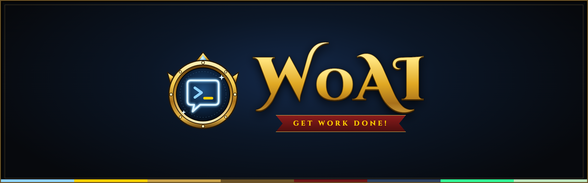

<p align="center"></p>

# WoAI

<p align="center"><b>English</b> · <a href="README.es.md">Español</a></p>

An addon for **WoW Forever** (interface `16001`) to read and continue your **Claude Code** and **Codex** conversations without leaving the game.

> The in-game UI is currently in Spanish. Button and command names below are shown as they appear in the game, with a translation in parentheses.

## Install the app (recommended)

The **WoAI** desktop app installs the addon, runs the companion in the background and lets you configure everything without a terminal. You don't need Node.

1. Download the installer from [Releases](https://github.com/alcheco/world-of-ai/releases/latest):
   - **macOS:** `WoAI_…_AppleSilicon.dmg` (M1 chip or later) or `WoAI_…_Intel.dmg`. Open it and drag **WoAI** onto **Applications**.
   - **Windows:** `WoAI_…_x64-setup.exe`.
2. Open WoAI. A short wizard asks for the language, finds WoW Forever, detects `claude` and `codex`, lets you choose what the agents may do, and installs the addon.
3. **Fully quit WoW and reopen it**, then enable **WoAI** and every **WoAI slot** under AddOns (steps 4 and 5 below).

In **General** you choose whether WoAI shows as a normal window or only in the menu bar / tray, and whether it opens when you log in. Closing the window does not stop the companion; to exit, use **Quit WoAI**. If WoAI is menu-bar-only and you can't find its icon, open WoAI again from Applications and the window shows up. Updates are installed from the app itself.

> The macOS build isn't notarized yet. If macOS says the app "is damaged" or "can't be opened", run `xattr -dr com.apple.quarantine /Applications/WoAI.app` once.

The rest of this page explains how to run it from the repo (for development).

## How it works

WoW addons can't use the network or run programs. That's why WoAI has two parts:

| Part | Where it runs | What it does |
|---|---|---|
| `addon/WoAI` | In the game | Shows the UI, reads `Data.lua` and sends each prompt as a screenshot (with `WoAI_DB.outbox` in SavedVariables as a fallback). |
| `addon` `WoAI_S001…S100` | In the game | *LoadOnDemand* mailboxes that deliver replies without a `/reload`. |
| `companion/` | On your Mac (Node ≥ 22) | Watches `Screenshots/` and the SavedVariables, runs each prompt with `claude -p --resume` or `codex exec resume`, rewrites `Data.lua` with the sessions from `~/.claude/projects` and `~/.codex/sessions`, and publishes each reply to the mailboxes. |

```
you type a prompt ─► screenshot ─► the companion runs it ─► the reply shows up on its own
```

**Outbound (no `/reload`):** the game only writes SavedVariables on `/reload` or logout, but `Screenshot()` writes a file immediately. When you press **Enviar** (Send), the addon briefly draws the prompt as a grid of colored cells in the top-left corner (you'll see a flicker) and takes a PNG screenshot. The companion decodes it (measures the cells, calibrates the colors and checks a checksum), queues the prompt and deletes the screenshot; your normal screenshots are left alone. If the screenshot fails, the prompt stays in the outbox and goes out on the next `/reload`. `/woai enviar` retries any that didn't go out.

**Inbound (no `/reload`):** a *LoadOnDemand* addon reads its Lua from disk at the moment it's loaded. The companion writes each update to the 100 mailboxes `WoAI_S001…` and the addon loads the next free one. To know when, the addon checks every 2 s whether `sig/NNN.wav` can be played: the companion turns that empty `.wav` into a valid (silent) one when a prompt finishes. If signals don't work (for example, with sound turned off), the addon loads mailboxes on a schedule (10 s, 25 s, 45 s, 75 s, 2 min, then every 2 min) while prompts are pending. Each mailbox can be used once per UI session; `/reload` frees them all.

The game only discovers files that existed at startup, so `npm run install-addon` creates them ahead of time, and then you need to **fully quit WoW and reopen it** once.

## Tutorial: loading it for the first time

### 0. Requirements

- macOS with **WoW Forever** installed (by default in `/Applications/World of Warcraft/_forever_`).
- **Node.js 22 or later** (`node -v`).
- At least one of the CLIs, already signed in:
  - **Claude Code:** `claude` (try it with `claude -p "hello"`).
  - **Codex:** `codex` (try it with `codex exec "hello"`).

### 1. Clone the repo

```bash
git clone https://github.com/alcheco/world-of-ai.git
```

```bash
cd world-of-ai/companion
```

### 2. Configure (optional, but recommended)

Create `companion/config.json`. With this content Claude can edit files when you message it from the game:

```json
{
  "claude": { "permissionMode": "acceptEdits" },
  "codex": { "sandbox": "workspace-write" }
}
```

If your WoW Forever is in another folder, add `"wowDir": "/path/to/_forever_"`. The other options are under [Configuration](#configuration).

### 3. Install the addon in the game

```bash
npm run install-addon
```

This command:
- Links `addon/WoAI` into `_forever_/Interface/AddOns/WoAI`. It's a symlink, so whatever you change in the repo shows up in the game.
- Creates the 100 mailboxes `WoAI_S001…WoAI_S100` and the signal files for the live channel.

### 4. Fully restart WoW

**Quit the game completely and reopen it.** A `/reload` isn't enough: WoW only discovers new files at startup. Do this every time the addon gets a new `.lua` file too.

### 5. Enable the addons

On the character select screen, open **AddOns** (bottom left):
- Check **WoAI** and every **WoAI slot …**. They're grouped under *WoAI*.
- If they show up as "out of date", check **Load out of date AddOns**.

### 6. Start the companion

In a terminal, and leave it open while you play:

```bash
npm start
```

You should see `[woai] SavedVariables vigiladas: …` and `[data] Data.lua actualizado: N sesiones`. Set `"lang": "en"` in `config.json` to get these messages in English.

### 7. Log in and try it

1. Log in with your character. The chat shows `WoAI: N sesiones…`.
2. Open the window with the **book button on the minimap**, with `/woai`, or from the addon compartment.
3. Press **+ Nueva** (New), pick the agent (Claude or Codex) and a folder, type `hello` and press **Enviar** (Send).
4. You'll see a flicker in the top-left corner (that's the prompt leaving as a screenshot) and a *Esperando respuesta* (Waiting for reply) quest under the quest tracker.
5. When the agent finishes, the **"¡Misión completada!"** (Quest complete!) banner appears. Click the quest to open the conversation.

### Troubleshooting

| Symptom | What to do |
|---|---|
| No minimap button and no `/woai` | Check that WoAI is enabled and fully restart WoW (step 4). |
| The window says "Sin datos" (No data) | The companion isn't running or can't find the game folder. Check the terminal and `wowDir`. |
| The prompt doesn't go out | `/woai enviar` retries it. Otherwise it goes out on the next `/reload`. |
| The reply doesn't arrive on its own | `/woai estado` shows the live channel and free mailboxes. `/woai poll` forces a read, and `/reload` always works. |
| Claude replies that it can't edit | Set `"permissionMode": "acceptEdits"` in `config.json` and restart the companion. |
| Lua errors show up | Copy the full error and report it. |

To uninstall: `npm run uninstall-addon` (removes `_forever_/Interface/AddOns/WoAI` and the `WoAI_S*` folders; if it was a symlink, the repo is left untouched).

## Usage

- **Minimap button:** click opens the window, right-click collapses the quests, and dragging moves it around the edge. It shows a green dot when there are new replies.
- **Window:** drag to move, resize from the bottom-right corner. It remembers its position and size.
- **Markdown in replies:** larger gold headings, code blocks in a dark box with their language, tables as a grid with a header, bulleted or numbered lists (nested and with checkboxes too), quotes, and colors for **bold**, *italic*, `code` and links.
- **Left list:** recent sessions **grouped by project** (repo). Claude worktrees (`.claude/worktrees/…`) and Codex worktrees (`~/.codex/worktrees/…`) go under their repo's group. A colored stripe shows the agent: orange for Claude, green for Codex. Click a project to collapse it. There are *Todos / Claude / Codex* (All / Claude / Codex) filters and a search box.
- **WoAI quests:** a block under the quest tracker with each prompt shown as a quest: *Enviando…* (Sending…), *Esperando respuesta* (Waiting for reply) or *Respuesta lista* (Reply ready). When you log in with new replies, the "¡Misión completada!" banner appears with its sound.
  - Click a quest: opens the conversation.
  - Right-click a quest: dismisses it.
  - Shift + drag: moves the block.
  - Right-click the header: puts it back under the quests.
- **Careful when continuing a session you have open** in Claude Code or Codex: the companion resumes it in parallel, so that reply won't show up in the app you have open.
- **Continue a session:** select it, type the prompt and press **Enviar** (Send). No `/reload` needed: the reply appears on its own when the companion finishes, with the quest complete banner.
- **`/woai estado`** (status): shows whether the live channel works, how many mailboxes are left and how many prompts are waiting. **`/woai poll`** loads a mailbox right away.
- **+ Nueva** (New): the agent button switches between Claude and Codex. The folder button cycles through the projects the companion knows about and, at the end, **Solo chat** (Chat only): a conversation with no working folder and no tools, which creates nothing on disk. Claude runs with no tools; Codex doesn't allow removing them all, so it runs read-only. These conversations are grouped under "Solo chat" and stay that way when continued.
- **Prompt states:** *enviando…* (sending), *en cola* (queued), *ejecutando…* (running), *listo* (done) or *error* (the error includes the CLI's message). Replies arrive without `/reload` while mailboxes remain; if they run out, do a `/reload`.

## Configuration

Create `companion/config.json` (optional) to change the defaults:

```json
{
  "wowDir": "/Applications/World of Warcraft/_forever_",
  "maxSessions": 40,
  "maxMessages": 60,
  "claude": { "permissionMode": "acceptEdits" },
  "codex": { "sandbox": "workspace-write" }
}
```

- `claude.permissionMode`: with `default`, Claude **can't** use tools that ask for permission, because there's no way to approve them from the game. Use `acceptEdits` if you want it to edit files.
- `codex.sandbox`: `read-only`, `workspace-write` or `danger-full-access`.
- `wowDir`: if you leave it out, the companion looks for WoW Forever in the usual macOS and Windows paths (and, on Windows, in the install registered by Battle.net).
- `claude.bin` / `codex.bin`: name or path of the CLI. The companion fills in PATH from your login shell and the usual folders (`~/.local/bin`, Homebrew, global npm), so you normally don't need this.
- `lang`: language of the companion's messages, `es` or `en`.
- Environment variables: `WOAI_WOW_DIR` (game folder), `WOAI_LANG`, `WOAI_DATA_DIR` (where `config.json` and `.state.json` live; `companion/` by default) and `WOAI_ADDON_SRC` (copy the addon from another folder instead of linking the repo's).

## Development

```bash
cd companion && npm test      # tests
npm run once                  # process the outbox once and regenerate Data.lua
npm run install-addon -- --copy   # install the addon by copying it, like the app does
npm run build:bin             # single binary (Node SEA) in dist/woai-companion-<target>
```

The binary is what the desktop app bundles (see [docs/plan-instalador.md](docs/plan-instalador.md), in Spanish). It's built on each platform with its own Node. With `--ipc` it talks to the app over JSON; the protocol is in [docs/companion-ipc.md](docs/companion-ipc.md).

### Desktop app

```bash
cd app && npm install
npm run tauri dev             # app in development (compiles the companion and copies the addon first)
npm run tauri build           # installer for this platform in app/src-tauri/target/release/bundle/
npm run icons                 # regenerate the icons from docs/brand (macOS)
```

The updater checks for signed builds, so a local `tauri build` needs the signing key: `TAURI_SIGNING_PRIVATE_KEY="$(cat ~/.tauri/woai-updater.key)" TAURI_SIGNING_PRIVATE_KEY_PASSWORD="" npm run tauri build`.

### Publishing a version

```bash
node scripts/bump.mjs 0.2.0   # same version for app, companion and addon
git commit -am "v0.2.0" && git tag v0.2.0 && git push --follow-tags
```

The tag triggers [.github/workflows/release.yml](.github/workflows/release.yml): it builds the `.dmg` (Apple Silicon and Intel) and the Windows `.exe` and leaves them in a **draft** Release with `latest.json`. Publish the draft and installed apps will offer the update. It needs the repo secrets `TAURI_SIGNING_PRIVATE_KEY` (contents of `~/.tauri/woai-updater.key`) and `TAURI_SIGNING_PRIVATE_KEY_PASSWORD` (empty). **Keep that key safe:** without it, installed apps can't be updated.
